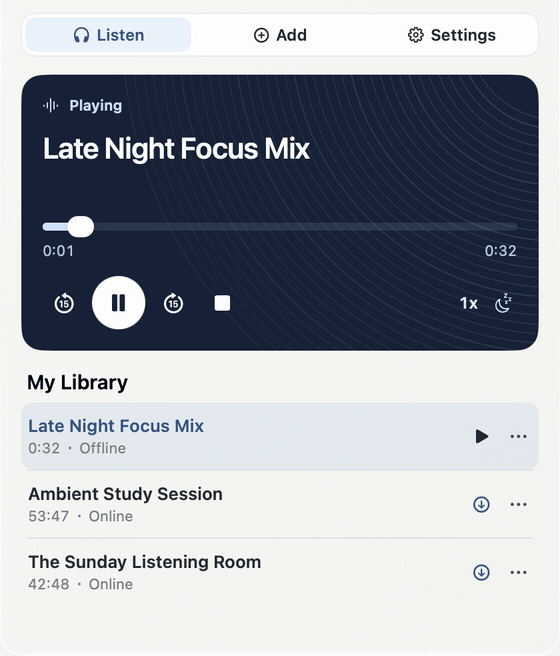

# FlowBar

FlowBar plays long-form YouTube audio from the macOS menu bar. Add a mix, podcast, or ambient track, stream it while FlowBar saves a copy, and pick up where you left off online or offline.

[Website](https://flowbar.drugoi.dev/) · [Download for macOS](https://github.com/drugoi/flowbar-macos/releases/latest)

## See FlowBar in action

<a href="https://flowbar.drugoi.dev/#demo">
  <picture>
    <source media="(prefers-reduced-motion: reduce)" srcset="docs/assets/flowbar-demo-poster.jpg">
    
  </picture>
</a>

[Watch the full demo on the website](https://flowbar.drugoi.dev/#demo).

## Features

- Play, pause, scrub, or skip 15 seconds from the menu bar.
- Save tracks for offline listening with a configurable cache limit.
- Keep a personal library and resume each track from its saved position.
- Adjust playback speed or set a sleep timer.

## Install

FlowBar requires macOS 13 or later. Unzip the [latest release](https://github.com/drugoi/flowbar-macos/releases/latest), move `FlowBar.app` to Applications, and launch it. Click the FlowBar icon in your menu bar to open the player.

## Issues & Feedback

If you run into a problem, include your macOS version and the steps to reproduce it when you [open an issue](https://github.com/drugoi/flowbar-macos/issues).

## Legal
All content belongs to their respective owners. Use FlowBar in accordance with YouTube's Terms of Service and applicable laws. FlowBar is not affiliated with or endorsed by YouTube or Google.
